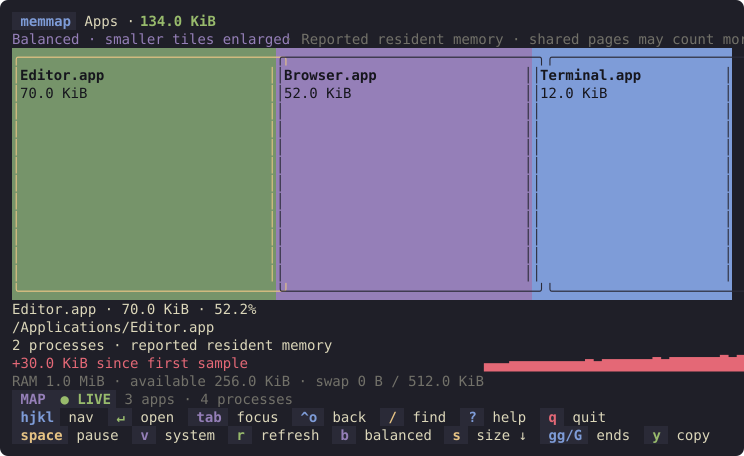

# usage-tui

Two standalone Kanagawa Wave terminal treemaps for macOS and Linux. They do
not depend on the `dotfiles` CLI or change bootstrap behavior.



```sh
cargo install --path usage-tui --locked
diskmap [PATH]
diskmap --apparent ~/Downloads
memmap
memmap --view system --interval 5
```

Requires Rust 1.88 or later and an interactive terminal. `diskmap` defaults
to the current directory. `memmap` defaults to Apps and a two-second interval;
`--interval` accepts fractional seconds from 0.1 to 86400.

## Controls

- `h/j/k/l` or arrows: move spatially between tiles, sequentially in the list.
- `Enter`: open a folder, Other collection, app, or detail dialog.
- `Ctrl+O` or Backspace: return to the previous folder or view. In diskmap,
  when history is empty, go up to the parent directory, including above the
  launch directory. The folder you left stays selected.
- Tab: switch map/list focus. Narrow screens show the list when it has focus.
- `gg` / `G` or Home / End: first / last entry. Page Up / Down moves a list
  page; these shortcuts focus the list.
- `s`: switch size descending / name ascending, retaining selection.
- `b`: toggle balanced / proportional tile sizing, retaining selection.
- `y`: copy the selected file, folder, app bundle, or executable path.
- `/`: fuzzy name search; Enter keeps the filter, Escape restores the previous
  filter. Escape outside search clears the filter.
- `?`: help. Escape closes dialogs; `j/k` scroll detail and Trash dialogs.
- `r`: refresh. Disk refresh cancels the old scan and rescans the scan root;
  memory refresh takes a sample and reorders by size.
- `q` or `Ctrl+C`: quit.
- Disk: `a` toggles allocated/apparent bytes; `d` opens Move to Trash.
  Review the full path and size, then press `y` to confirm or `n`/Escape to cancel.
- Memory: `v` switches Apps/System; Space pauses/resumes updates.

The footer uses colored key badges, context-sensitive actions, focus and
status indicators. Disk details sit on a Kanagawa panel with blue names and
paths, green sizes, violet percentages and file types, and amber warnings.
The list and dialogs have rounded borders; each list shows
its sort order and selection count. Narrow terminals display whole hints
that fit, with the full controls available under `?`.

Filled tiles use a squarified layout accounting for tall terminal cells.
Balanced sizing is the default: 65% of the canvas is shared equally between
nonzero entries, and 35% follows the square root of their byte counts. This
limits oversized tiles and gives smaller entries room for labels. Tile areas
in this mode are adjusted for readability; sizes and percentages always use
actual bytes. Press `b` for proportional areas when comparing usage visually.
Balanced tiles need at least ten columns and four rows before being shown
individually; entries that cannot fit join Other.
Colors follow item identities. Small entries share an Other tile; opening it
focuses its individual entries in the list. Wide screens show a synchronized
side list. Very small screens use only a list. Zero-byte and unavailable
entries always remain accessible through the list. Filtered percentages use
the matched set; the header also shows the unfiltered total.

## Disk accounting and Trash

Scanning runs on a background worker with bounded batches and cancellation.
Folders and files appear as they are discovered, and descendant bytes update
their ancestors immediately. Sizes and percentages are provisional until the
scan completes. Completed trees stay in memory, so navigating does not rescan.
Scans run at launch, explicit refresh, after successful trashing, and when
going above the scan root. Going up expands the scan root to the parent and
scans it in the background; subsequent refreshes use that expanded root.
During a rescan newly scanned folders show provisional results; locations not
yet visited retain the previous cached view. Missing locations return to the
nearest surviving parent when the scan finishes. Move to Trash waits until
scanning completes.

Hidden entries are included. Symlink targets are never followed; symlink
storage itself is counted. Different filesystems are skipped and marked.
Unreadable or vanished entries are marked, and affected ancestors show notes;
their totals are incomplete. Directory metadata and special-file data are
excluded. Hard links share data ownership with the first path encountered in
sorted depth-first traversal; later links show zero attributed bytes.
Normal symlinks and hard links have informational notes and do not mark their
ancestors as incomplete.

Allocated bytes use Unix `st_blocks × 512`; apparent bytes use `st_size`.
Both are collected in one scan. Allocated usage is an estimate, particularly
on APFS: clones, snapshots, and compression make it different from reclaimable
space. Files changing during scanning can also make totals inconsistent;
refresh to obtain another estimate.

Move to Trash uses the `trash` crate's native macOS or Linux support. It
protects the scan root, requires explicit confirmation, rechecks device/inode,
file type, change time and canonical parent, and rejects duplicate requests.
Synthetic Other tiles cannot be trashed. A failed Trash operation reports an
error; it never falls back to permanent deletion. Revalidation is a check
immediately before the native call, not an atomic filesystem transaction.
Moving to Trash may not free space until Trash is emptied. Selected paths are
never executed as shell commands.

macOS uses `NSFileManager`, avoiding Finder automation permissions. Finder's
Put Back command may be unavailable; entries can still be dragged out of Trash.
Non-UTF-8 paths are browsable but cannot be trashed on macOS because the native
adapter cannot safely represent them. Scan cancellation is checked between
entries; a blocked kernel filesystem call may take time to return.

## Memory accounting

Apps sums **reported resident process memory**, as collected by `sysinfo`.
Shared pages can appear in several processes. Percentages use the process
view's total, never physical RAM. Threads are excluded from Linux process
enumeration to avoid counting each thread's process memory again.

On macOS the outermost `.app` path groups helpers with their application.
Other macOS processes and Linux processes group by executable path, falling
back to process name when the path is unavailable. Enter an app to inspect
individual processes; Enter a process for PID, start time, executable,
resident memory, and command. Restricted metadata is labeled unavailable;
zero reported resident bytes may also mean unavailable information.

System uses non-overlapping physical RAM categories:

- macOS: Free, Active, Inactive, Wired, Compressed, Other, from native Mach VM
  counters. Speculative pages are already in Free; purgeable and file-backed
  counters appear only as overlapping statistics in details.
- Linux: Free, Active, Inactive, Kernel, Other, from `/proc/meminfo`. Kernel
  includes slab, kernel stacks, and page tables. Cache and available memory
  appear only in details.

Other is the remainder of physical RAM. Inconsistent or unavailable system
samples show a warning and retain the last valid breakdown. Available RAM and
swap remain visible in the detail panel. Tile order stays stable between
samples; `r` reorders by size. Selection follows app identity or PID plus
start time, so exiting processes and reused PIDs are handled separately.
Pause stops scheduled sampling; `r` still requests one sample while paused.
Inspection is read-only: no process termination is provided.

The detail panel shows a sparkline of the last 120 samples and growth since
the entry's first observed sample. The baseline remains fixed as old samples
leave the graph. Exited processes leave the history; PID reuse starts a new
history because start time forms part of the identity.

Memory tile sizes settle small changes: rectangles stay in place while each
tile's share changes by at most four percentage points and the combined
change stays within eight points of the last layout. Other uses different
entry/exit thresholds to reduce churn. Displayed bytes and percentages stay
current. Larger changes, resizing, view/search/sort changes, and `r` refresh
the layout. `r` also selects size sorting.

Clipboard copying runs on a worker. Local macOS uses `pbcopy`; Linux uses
`wl-copy`, `xclip`, or `xsel` when available for the current desktop session.
Remote sessions and unavailable native clipboards use OSC 52, which requires
terminal/multiplexer clipboard support. The status distinguishes a completed
native copy from a terminal clipboard request. Paths are sent as data, never
executed.

The UI waits for keyboard, resize, scan, sample, or clipboard events. Idle
disk views and paused memory views have no polling or periodic redraw timer.

## Development

```sh
cargo fmt --manifest-path usage-tui/Cargo.toml -- --check
cargo clippy --manifest-path usage-tui/Cargo.toml --all-targets --locked -- -D warnings
cargo test --manifest-path usage-tui/Cargo.toml --all-targets --locked
```

Tests cover layout partitioning and rounding, aggregation, colors, navigation,
terminal sizes, disk fixtures, cancellation, mocked Trash operations, memory
accounting and state transitions, streamed scan accounting, history bounds,
and stable layouts. Rendered snapshots include text and color checks.
Automated PTY tests cover both commands, pause/refresh wakeups, and terminal
restoration after normal exit, errors, and panics. Native collector smoke tests
run on the current platform; CI runs the suite on both macOS and Linux.
Regenerate text snapshots after intentional
visual changes with `UPDATE_SNAPSHOTS=1 cargo test --manifest-path
usage-tui/Cargo.toml rendered_snapshots`.
